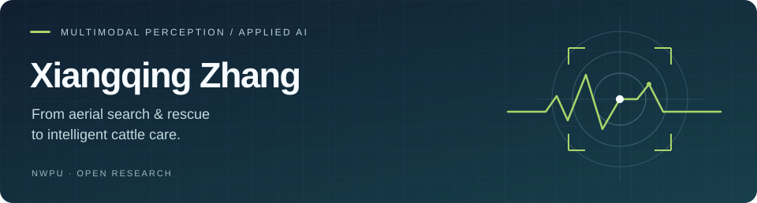

**张向清 · Xiangqing Zhang**  
Postdoctoral Researcher, **Northwestern Polytechnical University**

I study how to make perception reliable when targets are tiny, signals are weak, and sensors disagree. My work spans **UAV search & rescue, RGB–thermal fusion, and efficient vision models**.

&nbsp; 

## Aerial vision · Research code & data

| Project | Research focus |
| :--- | :--- |
| **[VTSaR](https://github.com/zxq309/VTSaR)** | Visible–thermal aerial person datasets and search-and-rescue benchmarks. |
| **[SGGB](https://github.com/zxq309/SGGB)** | Training-time gradient bridging for tiny person detection. *Manuscript under review.* |
| **[HFA-Mamba](https://github.com/zxq309/HFA-Mamba)** | High-frequency enhancement and scale-balanced learning on Mamba-YOLO. *Manuscript under review.* |

## Selected publications

- **[Aerial Person Detection for Search and Rescue: Survey and Benchmarks](https://doi.org/10.34133/remotesensing.0474)** — *Journal of Remote Sensing*, 2025. [Dataset ↗](https://github.com/zxq309/VTSaR)
- **[Transformer-Based Person Detection in Paired RGB-T Aerial Images With VTSaR Dataset](https://doi.org/10.1109/JSTARS.2025.3526995)** — *IEEE JSTARS*, 2025.
- **[Robust Aerial Person Detection With Lightweight Distillation Network for Edge Deployment](https://doi.org/10.1109/TGRS.2024.3421310)** — *IEEE TGRS*, 2024.

Ph.D. in Information and Communication Engineering, NWPU (2024). Research supported by the NSFC Young Scientists Fund and China's national postdoctoral researcher program.

---

**Let's collaborate** on multimodal perception, aerial search & rescue, or precision livestock sensing.  
[zxq1991@mail.nwpu.edu.cn](mailto:zxq1991@mail.nwpu.edu.cn) · Xi’an, China
